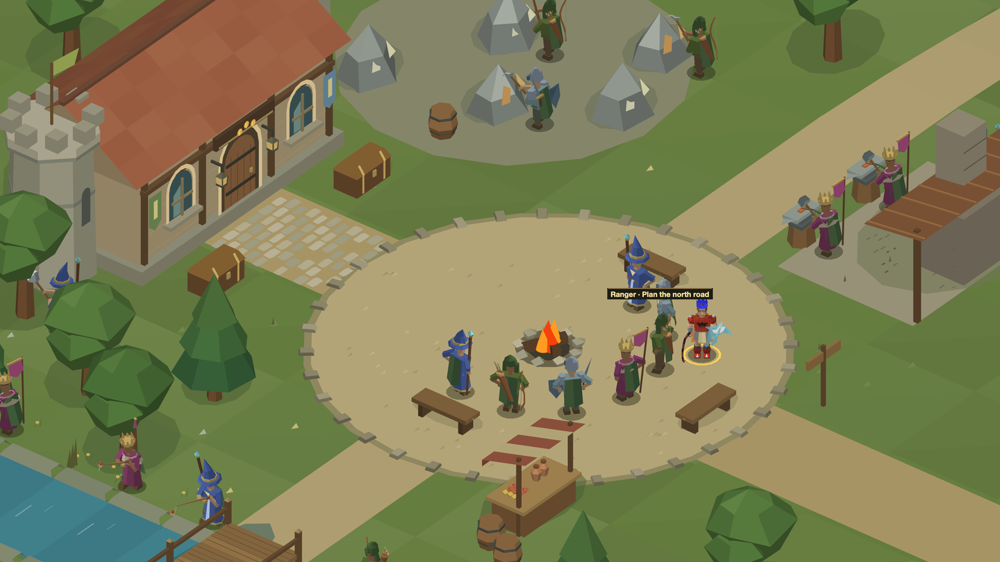

# RuneSpace

RuneSpace turns your Herdr agents into characters in a little medieval town. A working agent might swing a pick at the quarry or cast a line from the riverbank. Walk up to them and click to open their terminal. When they're ready for another task, look for them around the fire.

## Gameplay demo

Take a 52-second walk around the guild, open an agent's conversation, and return to the green.

https://github.com/user-attachments/assets/b9d74557-109c-4cc7-8af1-ad63f4224a7f

<details>
<summary>Guild world screenshot</summary>



</details>

## Install on macOS

On an Apple Silicon Mac, install Herdr and open it once. The official installer also installs Herdr Core if needed. [Herdr installation guide](https://github.com/herdrdev/herdr-app#install)

```sh
curl -fsSL https://releases.herdr.dev/app/install.sh | sh
open "$HOME/Applications/Herdr.app"
```

RuneSpace needs Metal, Node.js 22 or later, Python 3, and the Xcode Command Line Tools for Swift. If the command line tools are missing, run `xcode-select --install` and let the installation finish. Then install the mod. [Node.js downloads](https://nodejs.org/en/download)

```sh
git clone https://github.com/davidvgilmore/RuneSpace.git
cd RuneSpace
python3 scripts/install.py
```

With Herdr running, pick **RuneSpace** in the layout picker, then click **Guild world**. The first visit compiles the Metal renderer. You can also select the layout from a terminal.

```sh
herdr-app do layout.switch '{"name":"runespace"}'
```

The installer builds the world and places the mod, theme and layout in your Herdr app home. It uses `~/.config/herdr-app` by default and accepts `HERDR_APP_HOME` or `--app-home PATH`. Herdr itself updates through its usual channel. To update RuneSpace, run `git pull --ff-only` followed by `python3 scripts/install.py` in this checkout.

## Bring teammates into Guild world

Open **Guild world → Call → Copy guest invite** on the host. If your guild uses a shared Tailscale VM, give teammates both the VM share link and the RuneSpace guild invite. Each teammate connects Tailscale on their Mac to their own tailnet and accepts the VM share once. [Tailscale machine sharing](https://tailscale.com/docs/features/sharing)

To bring agents, start them in terminals in your own Herdr (for example, `codex` or `claude`). Copy the **RuneSpace guild invite**, open **RuneSpace → Guild world → Call**, enter your display name, select **Bring my agents**, and click **Join with copied invite**. Everyone meets on the same map. You can also open the guild invite in a browser to visit without bringing agents.

Shared agents wear their harness outfits and show who brought them. Working agents take available jobs around town and idle agents gather at the commons. Each teammate can change agent sharing in **Call** during a visit. If they already host a guild, they can leave their call, choose **Visit another guild**, and use **Return to my guild** afterward. Only the person running an agent can open its private Herdr conversation. Nearby voice and video stay connected through chats and inventory. Microphone and camera start off.

Walk up to an agent to chat, click an oak to chop, or pick a goblin or giant rat to fight. Teammates see your outfit and actions. Your thread titles and conversations stay private. [Set up the shared guild and LiveKit](collaboration/README.md)

## Around town

| Action | Control |
| --- | --- |
| Walk | Click the ground or use the arrow keys |
| Chop wood or start a battle | Click a harvestable oak, goblin, or giant rat near the commons |
| Stop chopping or retreat | Click open ground, move with the arrow keys, or press Esc |
| Orbit and tilt the camera | A / D to orbit, W / S to tilt |
| Zoom | Scroll wheel |
| Talk to an agent | Click their character, or press Enter near them |
| Open your inventory | I |
| Dance | G |
| Music | M |

Codex agents are mages, Claude agents are rangers, and Hermes is the guildmaster. OpenCode warriors carry a sword and kite shield. Pi druids wear moss-green robes and a linen hood. Both stow their gear to chop trees, mine ore, fish, work the forge, or rake an allotment. Idle agents gather at the commons. After 30 minutes idle they leave the map and appear offline in the friends list.

Two oaks grow south of the campfire, near the market. Click one and your character walks to the trunk, draws an axe and chops until the tree becomes a stump. You earn one oak log and 25 Woodcutting XP. The oak grows back after 20 seconds.

Across the lane, a goblin and a giant rat make for short, optional fights. Click either creature to engage with your equipped weapon. Hits appear over the characters, and you can walk away at any time. A win earns Combat XP. If your hitpoints run out, you recover at the commons with your equipment and logs. Press **I** to see your logs and XP alongside your equipment.

Open **Inventory** to change any of seven equipment slots. The 29 cosmetics include all six partyhat colours, dragon chainbody, Bandos tassets, abyssal whip, Elysian spirit shield and fire cape. The two-handed Armadyl godsword takes both hands.

Press **M** in the world or click **Music** in the Guild header to open the track list over your current view. Pick any of the 43 tracks from *RuneScape: Original Soundtrack Classics*, from *Scape Main* to *Sea Shanty 2*. Press **Esc** to return to the world or your chat. The track keeps playing. Open **Music** again to pause or change songs. Playback streams from Bandcamp and needs an internet connection. [Soundtrack and listening guide](layout/mods/runespace/music/README.md)

## Connecting OpenCode and Pi

Open the interactive harness in a Herdr terminal, or start one with `hc run --bg opencode` or `hc run --bg pi`. Click its character to open that same terminal. Remote agents use the machine connections you've already set up in Herdr.

RuneSpace uses the harness's terminal status reports to tell when it is working. Pi 1.1 and newer and OpenCode builds with native program-status reporting work out of the box. An interactive harness without a report appears as **Unknown**. [Pi 1.1 release notes](https://github.com/earendil-works/pi/releases/tag/v1.1.0) · [OpenCode native reporting](https://github.com/anomalyco/opencode/pull/55172)

For Pi 0.80.2 or OpenCode 2.0.25's full TUI, install the matching reporter **on the machine running the harness**, then open a new interactive session. You can pass either name on its own. OpenCode's `mini` interface doesn't load this plugin.

```sh
python3 scripts/install-harness-status.py pi opencode
```

The installer writes a `runespace-status` extension under Pi's agent directory and a plugin of the same name under OpenCode's configuration directory. Both activate inside Herdr terminals. To remove one, delete its `runespace-status` directory.

## License and credits

RuneSpace's original code and artwork are available under the [MIT License](LICENSE).

RuneSpace is an independent fan-made Herdr mod inspired by the 2005–2009 RuneScape era. RuneScape is a trademark of Jagex. The world and character models were made for the mod. The screenshot shows a fictional roster.

The official soundtrack is © and ℗ 2018 Jagex Ltd., licensed to Laced Music Ltd. RuneSpace streams it through the official Bandcamp player. [Album and credits](https://runescape-ost.bandcamp.com/album/runescape-original-soundtrack-classics)

The bundled Pixelated MS Sans Serif typefaces are by lou and distributed under CC BY-SA 3.0. [Font credit and license](layout/mods/runespace/fonts/LICENSE-MSSansSerif.txt)
